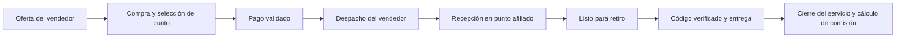

# LockBox — Proyecto y lógica de negocio actual

**Fecha de consolidación:** 26 de octubre de 2026.  
**Publicación en el repositorio:** 28 de octubre de 2026.  
**Contexto:** proyecto académico en desarrollo, orientado inicialmente a La Paz, Bolivia.  
**Moneda de referencia:** bolivianos (Bs).  
**Simulación económica vigente:** gestión 2027, elaborada el 15 de octubre de 2026.

Este documento reúne las decisiones conversadas, la documentación técnica local y los resultados de la última simulación. Distingue el modelo comercial propuesto, las funciones documentadas del prototipo y las decisiones pendientes. No constituye una nueva auditoría del repositorio remoto, de la base de datos ni del despliegue de producción.

## 1. Qué es LockBox

LockBox es una plataforma que combina software con una red de comercios afiliados para organizar la recepción, custodia temporal y entrega de productos vendidos por redes sociales.

El vendedor registra y gestiona sus productos y pedidos. El comprador selecciona un punto de recojo y retira allí su compra. El comercio afiliado recibe el paquete, lo conserva temporalmente y registra su entrega mediante un código asociado al pedido.

La propuesta busca reducir la coordinación manual, ofrecer trazabilidad y facilitar entregas en lugares y horarios conocidos. TikTok Live y otras redes pueden ser canales de captación y exhibición; el prototipo no incorpora una integración real con TikTok ni transmite video.

La visión original también contempla protección del pago mediante retención de fondos —escrow— y liberación después de una entrega válida. Esa visión debe distinguirse de la implementación disponible: actualmente no se procesan pagos, transferencias ni retenciones reales de dinero.

## 2. Modelo de operación: una red de puntos afiliados

La idea actual toma como referencia organizativa a los agentes BCP: negocios independientes que atienden operaciones y reciben una remuneración por transacción. La semejanza se limita a esa forma de organizar e incentivar una red; LockBox no tiene una afiliación declarada con BCP ni ofrece servicios bancarios.

Los llamados «puntos» o «sucursales» de la simulación son **comercios afiliados**, no locales propios atendidos por empleados de LockBox.

### 2.1. Responsabilidad del equipo dueño del sistema

- Desarrollar, instalar o configurar el sistema en cada punto.
- Capacitar al responsable del comercio para utilizarlo.
- Mantener el software, sus accesos y la infraestructura funcionando.
- Dar soporte técnico y atender incidencias que requieran intervención central.
- Mantener las reglas de operación, la trazabilidad y el cálculo de las comisiones.
- Gestionar la incorporación de comercios y supervisar el desempeño de la red.

El objetivo es que el equipo tenga poca intervención en la recepción y entrega cotidiana de paquetes. Eso requiere que los comercios operen el servicio con autonomía y que existan procedimientos claros para las excepciones.

### 2.2. Responsabilidad del punto afiliado

- Informar su dirección, horarios y capacidad disponible.
- Recibir los paquetes destinados a su punto y registrar la recepción.
- Conservarlos de manera ordenada y segura durante la custodia.
- Preparar los pedidos para su retiro.
- Verificar el código y confirmar la entrega por el sistema.
- Registrar incidencias y evitar entregas duplicadas o sin autorización.

El punto recibe una comisión por pedido atendido conforme a la regla comercial, usando su espacio y personal. Su comisión es un ingreso bruto del comercio; no representa automáticamente su utilidad después de sus propios costos.

### 2.3. Transporte y alcance físico

En el flujo planteado, el vendedor deja el producto en el punto seleccionado. La simulación no incluye reparto a domicilio, transporte entre puntos ni una flota propia de LockBox.

El nombre LockBox no implica que ya existan casilleros automáticos. La vista del punto registra recepción y entrega; la documentación técnica deja pendientes la cámara, el hardware de apertura y la integración con cerraduras.

## 3. Participantes y permisos del negocio

| Participante | Función principal | Límites principales |
|---|---|---|
| Comprador | Consultar productos, efectuar una compra y retirar el pedido en el punto elegido. | Solo debe acceder a sus datos y operaciones. No confirma por sí mismo acciones del vendedor o del punto. |
| Vendedor | Gestionar tienda, catálogo, pedidos, despacho y consultas de saldo. | No puede confirmar la recepción en el punto, validar el QR de entrega ni liberar dinero desde su panel. |
| Operador del punto | Recibir, preparar y entregar pedidos asignados a su comercio. | No administra toda la red ni puede modificar pagos o pedidos de otros puntos. |
| Equipo administrador de LockBox | Mantener el sistema y gestionar la red y sus excepciones. | Sus responsabilidades deben separarse del acceso cotidiano de un operador afiliado. |
| Sistema | Verificar permisos, guardar cambios, calcular importes y conservar el historial. | Los cálculos y autorizaciones deben resolverse en el servidor; no depender de datos manipulables del navegador. |

El registro documentado admite comprador, vendedor y operador de punto. Crear una cuenta de operador no equivale a obtener administración global. Los criterios comerciales de aceptación de un nuevo afiliado todavía deben formalizarse.

## 4. Flujo de negocio previsto

1. **Registro.** El usuario crea su cuenta y elige su rol. El vendedor registra su tienda; el operador registra los datos de su punto.
2. **Catálogo.** El vendedor crea productos, indica precio y existencias y publica los que están disponibles.
3. **Selección.** El comprador elige productos y un punto habilitado para recibir su pedido.
4. **Compra y pago.** El sistema crea el pedido y, en la visión comercial completa, valida el pago mediante un proveedor. La protección de fondos requiere una integración futura.
5. **Despacho.** El vendedor lleva el paquete al punto y registra el despacho de un pedido que ya está pagado.
6. **Recepción.** El operador confirma que recibió el paquete en el punto correcto.
7. **Preparación.** El operador registra que el pedido está listo para retiro.
8. **Entrega.** El comprador presenta su código; el operador consulta el pedido y confirma la entrega válida.
9. **Cierre económico.** En el modelo comercial propuesto, el pedido atendido genera la tarifa del servicio y la comisión del punto. La liquidación efectiva necesita su propia conciliación e integración de pagos.



**Alcance del diagrama:** describe el flujo objetivo del negocio. No implica que el checkout, el proveedor de pagos y la liquidación ya estén conectados de extremo a extremo.

### 4.1. Estados y trazabilidad

La secuencia operativa documentada es:

```text
pending → paid → dispatched → in_lockbox → ready → delivered
pendiente → pagado → despachado → recibido en punto → listo → entregado
```

También existen estados y casos de prueba para cancelación, reembolso, disputa y liberación del pago. Sus políticas completas todavía deben consolidarse para la operación comercial.

- El vendedor puede efectuar la transición `paid → dispatched`.
- El punto confirma, en orden, `dispatched → in_lockbox → ready → delivered`.
- Cada cambio debe conservar fecha, actor y estado en el historial.
- El sistema rechaza saltos de estado, códigos vencidos, pedidos ajenos y entregas repetidas.
- **Entregado y pago liberado son hechos distintos.** En la integración documentada del punto, entregar guarda la fecha de entrega y el historial; no libera dinero ni modifica el saldo del vendedor.

## 5. Modelo de ingresos vigente para la evaluación

La última simulación utiliza una tarifa fija por pedido atendido:

| Concepto | Supuesto vigente |
|---|---:|
| Tarifa del servicio LockBox | Bs 8,00 por pedido atendido |
| Comisión del punto afiliado | Bs 4,00 por ciclo completo atendido |
| Otros costos variables iniciales | Bs 1,50 por pedido atendido |
| Contribución inicial para LockBox | Bs 2,50 por pedido atendido |

Los Bs 8 corresponden al **servicio**, separados del valor de la mercadería. El importe de los productos pertenece al vendedor y no se contabiliza como ingreso propio de LockBox en esta simulación.

La referencia económica es un pedido cuyo ciclo de atención se completa. La comisión no se calcula por cada escaneo ni por cada cambio de estado. No se ha definido todavía una periodicidad definitiva de pago a los afiliados.

Quedan por decidir quién paga la tarifa de Bs 8 —comprador, vendedor o ambos mediante una distribución explícita— y en qué momento se cobra. La simulación reconoce el ingreso por pedido atendido y no modela cobros anticipados ni devoluciones de esa tarifa.

### 5.1. Fórmulas económicas

Para un mes determinado:

```text
Ingresos del sistema = pedidos atendidos × Bs 8
Comisiones a puntos = pedidos atendidos × Bs 4
Otros costos variables = pedidos atendidos × Bs 1,50 × índice de costos del mes
Contribución de LockBox = ingresos − comisiones − otros costos variables
Pago promedio por punto = comisiones totales de la red ÷ puntos activos
```

En enero, el índice de costos es 1:

```text
Contribución por pedido = 8 − 4 − 1,50 = Bs 2,50
```

En diciembre, el índice supuesto es 1,16:

```text
Otros costos por pedido = 1,50 × 1,16 = Bs 1,74
Contribución por pedido = 8 − 4 − 1,74 = Bs 2,26
```

El crecimiento de pedidos puede aumentar el monto mensual disponible para LockBox aunque la contribución por pedido disminuya en ciertos meses.

### 5.2. Contribución y ganancia del equipo

La contribución es lo que queda después de comisiones a los puntos y otros costos variables. Todavía debe cubrir los costos fijos del equipo y del sistema.

Para estimar utilidad neta será necesario presupuestar los gastos que correspondan, como remuneraciones, infraestructura fija, soporte, depreciación, intereses e impuestos. La inversión inicial y las fechas de cobro y pago también deben incluirse en el flujo de efectivo.

**La contribución calculada corresponde a todo LockBox, no a cada integrante del equipo.** Aún no se definieron sueldos, porcentajes de propiedad ni reglas de distribución de utilidades.

### 5.3. Relación con los planes del prototipo anterior

La primera propuesta contemplaba planes Emprende y Pro, comisiones porcentuales sobre ventas, una tarifa de protección menor y posibles cargos por sobreestadía. El prototipo conserva planes de prueba con comisión de 6% y 2% y plazos de disponibilidad de 48 y 0 horas después de la liberación.

Esas reglas técnicas históricas **no se suman automáticamente** a los Bs 8 del modelo actual. La última simulación solo incluye la tarifa fija de Bs 8, el pago de Bs 4 al afiliado y los otros costos variables indicados.

La continuidad comercial de los planes, su precio y su relación con la nueva tarifa requieren una decisión posterior y una adaptación del software. El precio cero de una suscripción de prueba no significa que el plan comercial sea gratuito.

## 6. Simulación de demanda y resultados

### 6.1. Supuestos de trabajo

| Parámetro | Valor utilizado |
|---|---|
| Periodo | Enero a diciembre de 2027 |
| Red | 12 puntos activos durante todo el año |
| Referencia de inicio | 50 pedidos mensuales por punto; alrededor de 600 en la red |
| Nivel inicial simulado | Distribución triangular de 45, 50 y 55 pedidos por punto |
| Trayectorias | 1.000 por escenario |
| Escenarios | Conservador, Base y Optimista |
| Crecimiento mensual Base | Triangular: mínimo 1%, moda 2% y máximo 3% |
| Estacionalidad de demanda | Enero = 1; diciembre = 1,7125 |
| Estacionalidad de otros costos | Enero = 1; diciembre = 1,16 |
| Capacidad supuesta | 12 espacios por punto, días operativos mensuales y estancia media de 2 días |

Los 50 pedidos corresponden al inicio del año, **no al promedio de los doce meses**. Se supone igual demanda esperada por punto. Los 12 puntos son una hipótesis de la simulación y no una afirmación de que existan 12 comercios afiliados operando realmente.

La demanda combina crecimiento, estacionalidad, un factor aleatorio compartido por la red y un conteo Poisson por punto. En cada realización se limita la atención a la capacidad del punto antes de sumar los resultados de la red.

La capacidad mensual es una aproximación: no simula la ocupación diaria ni colas o traslados de paquetes. La estancia de dos días usada para capacidad tampoco constituye por sí sola una política comercial definitiva de retiro o multas.

### 6.2. Resultado anual del escenario Base

| Indicador | Resultado aproximado |
|---|---:|
| Demanda esperada | 10.138,73 pedidos |
| Pedidos atendidos | 10.138,47 pedidos |
| Ingresos por el servicio | Bs 81.107,79 |
| Comisiones de los puntos | Bs 40.553,90 |
| Otros costos variables | Bs 15.909,21 |
| Contribución antes de costos fijos | **Bs 24.644,69** |
| Contribución mensual promedio de todo LockBox | **Bs 2.053,72** |
| Pago anual promedio por punto | Bs 3.379,49 |

Los valores conservan más decimales en los archivos fuente; el redondeo de cada concepto puede producir diferencias de un centavo al restarlos. Los pedidos esperados tienen decimales porque son promedios de muchas simulaciones; los pedidos generados en cada realización son enteros.

### 6.3. Monto mensual disponible para cubrir costos fijos del equipo

| Mes | Contribución de LockBox |
|---|---:|
| Enero | Bs 1.504,06 |
| Febrero | Bs 1.568,20 |
| Marzo | Bs 1.759,56 |
| Abril | Bs 1.831,71 |
| Mayo | Bs 1.924,37 |
| Junio | Bs 1.997,15 |
| Julio | Bs 2.140,01 |
| Agosto | Bs 2.097,02 |
| Septiembre | Bs 2.098,15 |
| Octubre | Bs 2.253,14 |
| Noviembre | Bs 2.602,17 |
| Diciembre | Bs 2.869,17 |

Como referencia para el comercio afiliado, el pago mensual promedio por punto pasa de aproximadamente Bs 200,54 en enero a Bs 423,18 en diciembre. No incluye los costos propios del comercio.

### 6.4. Incertidumbre: P10 y P90

P10 y P90 son percentiles de los pedidos simulados. Delimitan aproximadamente el 80% central de resultados del modelo, condicionado a sus supuestos; no son límites garantizados ni porcentajes que se suman o restan a la media.

- Enero, escenario Base: P10 = 516 y P90 = 697 pedidos de la red.
- Diciembre, escenario Base: P10 = 1.091 y P90 = 1.470,1 pedidos.
- El percentil mensual se calcula después de sumar los 12 puntos en cada realización.
- El percentil anual se calcula después de sumar los meses de cada trayectoria. No se obtiene sumando los percentiles mensuales.
- Los escenarios son alternativas y sus resultados no se suman entre sí.

### 6.5. Qué permiten concluir los resultados

La simulación muestra cómo podría evolucionar la operación bajo las condiciones elegidas. No demuestra demanda real, disposición a pagar Bs 8 ni rentabilidad neta. No se ha estimado elasticidad del precio y no se modelan cancelaciones, devoluciones ni entregas fallidas adicionales.

El punto de equilibrio, el flujo de efectivo y el valor presente siguen requiriendo inversión inicial, costos fijos, fechas de cobro y pago y una tasa de descuento.

## 7. Estado documentado del software

El proyecto está en una etapa temprana. La siguiente distinción se basa en la documentación local revisada; no implica una comprobación nueva de producción al 26 de octubre.

| Área | Estado documentado | Límite relevante |
|---|---|---|
| Registro y acceso | Sesión y perfiles reales; roles de comprador, vendedor y operador. | El entorno de desarrollo documenta acceso sin confirmación de correo y protección CAPTCHA. La configuración de producción debe verificarse por separado. |
| Vendedor | Catálogo, tienda, lives simulados, despacho, planes y solicitudes de liquidación persistidos mediante API y base de datos. | Los lives no transmiten video y las solicitudes de liquidación no transfieren dinero. |
| Comprador | Catálogo, carrito, checkout, pedidos y casos de reseña/disputa de demostración. | Las operaciones comerciales se guardan en el navegador; no crean compras reales en la base. La sesión y el perfil sí usan autenticación real. |
| Punto afiliado | Consulta de pedidos asignados, verificación de códigos y transiciones con persistencia en la base. | La entrega no libera pagos; no existe control integrado de cerraduras. Los códigos del comprador demo no habilitan retiros reales en este módulo. |
| Interfaz | Adaptación responsive, colores centralizados e iconos Lucide. | La existencia de una pantalla no equivale a tener terminado el proceso comercial completo. |
| Modelo tarifario | Nueva evaluación con tarifa fija y comisión por pedido. | Su conciliación con los planes y comisiones históricos del software está pendiente. |

El registro personal dejó de solicitar ciudad; los puntos siguen necesitando dirección física y datos operativos. En el registro del punto se documentan nombre, dirección y capacidad.

La arquitectura documentada utiliza Next.js y TypeScript en el frontend, Express y TypeScript en el backend y PostgreSQL con Supabase para autenticación y persistencia. Los permisos se verifican por usuario, rol y asignación del punto.

El trabajo inicial del vendedor se desarrolló en `vendedores` y la integración posterior en `backend-sellers`. La documentación del 12 de octubre registra integraciones de módulos en `main`. No se ha revisado el estado remoto actual de esas ramas para elaborar este resumen.

La última revisión local del despliegue indicaba frontend publicado y hosting del backend pendiente. No se asume que ese estado siga igual sin una nueva comprobación.

## 8. Reglas que deben conservarse al evolucionar el sistema

1. **Un pedido, un historial.** Cada movimiento debe quedar asociado al pedido, a su actor y a su fecha.
2. **Acceso por propiedad y asignación.** El vendedor solo opera su tienda; el afiliado solo opera sus puntos autorizados.
3. **Precio y condiciones históricas.** Cambiar un producto o plan no debe recalcular una venta anterior.
4. **Catálogo consistente.** Los productos comienzan como borradores; publicar requiere stock válido. Archivar debe conservar los pedidos históricos.
5. **Código validado en servidor.** No basta con conocer o mostrar un QR: deben comprobarse pedido, punto, vigencia y estado.
6. **Entrega y dinero separados.** Confirmar una entrega no debe permitir modificar libremente pagos ni saldos.
7. **Reintentos sin duplicaciones.** Una repetición de entrega, despacho o solicitud no debe generar efectos adicionales.
8. **Comisión trazable.** La liquidación futura al afiliado debe vincular cada importe con pedidos elegibles y evitar el doble pago.
9. **Separación de datos de prueba.** Los fixtures, pagos simulados y pronósticos deben identificarse y no presentarse como ventas reales.

Las primeras reglas ya aparecen en las integraciones documentadas. La facturación de Bs 8 y la liquidación comercial al afiliado necesitan completar su implementación y validación.

## 9. Decisiones pendientes antes de una operación comercial

| Tema | Qué falta definir |
|---|---|
| Pago del servicio | Quién paga los Bs 8, cuándo se cobran y qué ocurre si el pedido no se completa. |
| Afiliación | Requisitos, validación del comercio, capacitación, condiciones del acuerdo y activación del punto. |
| Comisión del punto | Periodicidad de liquidación, evidencia de cierre, conciliación y tratamiento de incidencias. |
| Custodia | Tamaños y tipos de productos admitidos, plazo de retiro, saturación, pérdidas, daños y pedidos abandonados. |
| Excepciones | Cancelaciones antes/después del despacho, devoluciones, disputas y reembolsos. |
| Protección del pago | Proveedor, responsabilidades, procedimiento de retención/liberación y condiciones de devolución. No se ha aprobado una garantía incondicional de reembolso. |
| Planes | Mantener, sustituir o adaptar Emprende y Pro al nuevo modelo de tarifa fija. |
| Costos | Presupuesto real de instalación, mantenimiento, soporte, infraestructura y remuneraciones. El monto variable de Bs 1,50 sigue siendo un supuesto agregado. |
| Escalamiento | Medir demanda y capacidad por ubicación; la simulación actual supone puntos equivalentes. |
| Operación del producto | Conectar el comprador con pedidos persistidos, pagos, códigos válidos y conciliación del ciclo completo. |
| Validación comercial | Probar aceptación de la tarifa, interés de vendedores y compradores e incentivo suficiente para los afiliados. |

## 10. Material disponible y referencias internas

### Evaluación económica y presentación

Los siguientes materiales se entregaron por separado y se conservan en la carpeta local de la entrega `LockBox_12_Puntos_2027`. No se incluyen en este commit ni se presentan como archivos disponibles en el repositorio:

- `LockBox_2027_12_Puntos.twbx`: libro editable de Tableau con seis vistas, una historia de seis pasos y los datos incluidos.
- `Guia_del_book.md`: guía para exponer el libro.
- `Metodologia.md`: fórmulas, método y límites de la simulación.
- `supuestos.json`: parámetros utilizados.
- `red_mensual.csv`: dataset mensual de la red.
- `resumen_anual.csv`: resultados anuales por escenario.
- `LockBox_2027_Entrega.zip`: entrega completa de simulación y documentación.

El nuevo libro de Tableau fue creado y verificado localmente. La publicación de esta nueva simulación en Tableau Public permanece pendiente según el último estado de la conversación.

### Documentación técnica relacionada disponible en main

- [Integración del vendedor](BACKEND_SELLERS.md).
- [Registro de perfiles](REGISTRO_PERFILES.md).
- [Integración del comprador](INTEGRACION_BUYERS.md).
- [Integración del punto](INTEGRACION_COLLECTION_POINT.md).
- [Registro sin ciudad](REGISTRO_SIN_CIUDAD.md).
- [Diseño responsive](RESPONSIVE.md).

La copia local consultada también contiene `REGISTRO_PUNTOS_LOCKBOX.md`, relativo al registro de operadores y puntos. Ese documento no aparece en `docs` de la rama `main` consultada para esta publicación; por ello no se enlaza como si estuviera publicado. La descripción del avance local no acredita que todas sus ampliaciones estén incorporadas en la rama remota.

Se utilizó el documento maestro original como antecedente de la visión del producto. Las decisiones posteriores de la conversación —red de afiliados, tarifa de Bs 8 y remuneración por pedido— prevalecen para describir el modelo económico actual.

Esta publicación añade únicamente esta documentación. No modifica código, configuración, datos de la base ni integra las ampliaciones locales pendientes.
