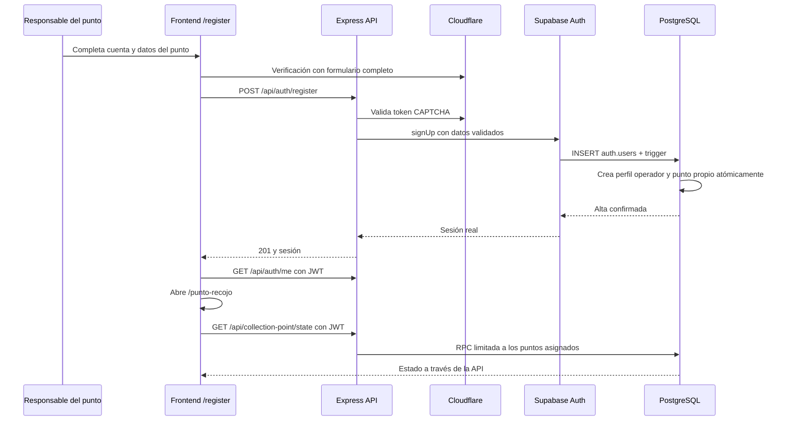

# Registro y vista de Punto LockBox

Fecha: 12 de octubre de 2026. Rama: `backend-sellers`, sobre `bb0e47e` (misma base que `main`). Proyecto Supabase: LockBox's Project (`anprldvvagovpyyenrif`).

## Comportamiento

`/register` permite elegir Comprador, Vendedor o **Punto LockBox**. Este último crea un perfil `operador_punto` y un nuevo punto activo cuyo `manager_id` es el ID del perfil recién creado. El alta no permite reclamar puntos existentes ni otorgar el rol global `admin`.

El responsable ingresa nombre personal, usuario, correo, contraseña y confirmación, celular de ocho dígitos, nombre del punto (2–80 caracteres), dirección completa (10–240 caracteres) y capacidad entera de 1–500 paquetes. El contacto del punto utiliza el celular del responsable. El backend agrega `+591` al almacenar el teléfono. Se mantienen las restricciones únicas de usuario y celular.

No se vuelve a agregar Ciudad al formulario ni a `profiles`. `lockbox_points.city` pasa a aceptar `NULL`: los puntos nuevos conservan la dirección completa y no se les inventa una ciudad. Los valores de los puntos existentes no cambian.

Cloudflare se activa solo cuando todos los campos del rol elegido están completos. Cambiar un campo o el rol invalida la verificación anterior. La validación de servidor se ejecuta antes de Auth; los campos del punto se aceptan exclusivamente para `operador_punto`.

Con el modo actual de Auth, el registro devuelve la sesión real y abre `/punto-recojo`. Si en el futuro se habilita confirmación de correo, se conserva el flujo compatible de confirmación y callback. No se cambió esa configuración ni ninguna clave de Vercel/Cloudflare.

## Vista y acceso

Se reutiliza y amplía `PointDashboard`, conectado a la API existente:

- Selector de los puntos propios activos y dirección registrada.
- Ocupación, capacidad, pedidos listos y entregas del día en horario de Bolivia.
- Guía Recibe → Prepara → Entrega, consulta de QR y confirmación separada de cada paso.
- Pedidos reales asignados al punto y actividad reciente; un punto nuevo comienza vacío.
- Actualización y cierre de sesión.
- Diseño responsive, controles con etiquetas, estados de carga/error, iconos Lucide y colores de `globals.css`.

`accountPath` dirige `operador_punto` a `/punto-recojo`. Las páginas de vendedor/comprador redirigen a ese destino si el perfil es operador. El servidor valida sesión, perfil activo y asignación; Express valida el JWT nuevamente para cada petición y la función SQL verifica propiedad del punto. `/admin` es un alias que redirige a la misma vista. Compradores y vendedores conservan sus rutas; responsables anteriores conservan asignaciones y rol.

La autorización utiliza `profiles.role` y `lockbox_points.manager_id`, nunca metadatos editables del usuario. Los operadores no reciben permisos para modificar directamente perfiles, asignaciones, pedidos o dinero. La lectura existente del directorio de puntos activos sigue disponible; el estado operativo y los pedidos se filtran por asignación dentro de la RPC.

## API y base de datos

| Método | Ruta                                    | Comportamiento                                                                                                            |
| ------ | --------------------------------------- | ------------------------------------------------------------------------------------------------------------------------- |
| POST   | `/api/auth/register`                    | Acepta el nuevo rol y los campos `pointName`, `pointAddress`, `pointCapacity`; verifica Turnstile y llama a Supabase Auth |
| POST   | `/api/auth/login`                       | Autentica con correo/contraseña y CAPTCHA, conservando el rol persistido                                                  |
| GET    | `/api/auth/me`                          | Devuelve el perfil activo del titular del JWT                                                                             |
| GET    | `/api/collection-point/state`           | Puntos asignados, pedidos y actividad                                                                                     |
| GET    | `/api/collection-point/scan/:qrCode`    | Consulta un código vigente de un pedido de los puntos propios                                                             |
| PATCH  | `/api/collection-point/:orderId/status` | Confirma recepción, preparación o entrega y registra historial                                                            |

La API usa los campos validados del punto como metadatos iniciales de Auth. El trigger privado `private.create_registration_profile()` valida nuevamente los datos y crea el perfil y punto dentro de la transacción del alta. Los compradores reciben su carrito; los vendedores, su suscripción. Los operadores reciben su punto y no recursos de otro rol. Los errores de validación o unicidad revierten toda la operación.

Migraciones aplicadas en este orden mediante Supabase:

1. `point_operator_role`, fuente `database/point-operator-role.sql`: agrega `operador_punto` al enum `public.user_role`. Debe confirmarse antes de utilizar el nuevo valor.
2. `point_operator_registration`, fuente `database/point-operator-registration.sql`: permite ciudad opcional en puntos, amplía el trigger y agrega el índice parcial `lockbox_points_active_manager_idx`.

No se crean tablas nuevas ni se amplían políticas de escritura. La función del trigger continúa privada, con `search_path` vacío y ejecución revocada a `public`, `anon` y `authenticated`. Los tipos del backend se regeneraron desde la base real.

## Verificación

- Backend: 20 pruebas HTTP aprobadas, incluyendo alta de los tres roles, campos obligatorios del punto, capacidad entera, rechazo de IDs/roles inyectados, CAPTCHA, sesión inmediata, perfil persistido y endpoints operativos.
- Frontend: 32 pruebas aprobadas (auth 7, punto 2, vendedor 15, comprador 7, configuración 1). Se comprueba que el nuevo rol espere todos sus datos antes del CAPTCHA y que la ruta de acceso sea correcta.
- TypeScript en frontend/backend y ESLint en los archivos modificados: sin errores.
- Build Next.js de producción con `--webpack`: aprobado; `/punto-recojo` se compila como ruta dinámica autenticada.
- `database/point-operator-verify.sql` ejecutado en Supabase con `ROLLBACK`: perfil/punto atómicos, comprador/carrito, vendedor/plan, aislamiento entre operadores, ausencia de elevación mediante metadatos, bloqueo de cambios directos y rechazo de altas inválidas. No quedan perfiles/puntos QA.
- También se ejecutaron `registration-checks.sql` y `collection-point-verify.sql` con `ROLLBACK`, para comprobar que los registros anteriores y las transiciones de pedidos mantienen su comportamiento.
- La revisión visual local y el alta mediante CAPTCHA en navegador no se completaron: el navegador no logró conectar al servidor local de pruebas. El flujo se comprobó mediante pruebas HTTP, SQL real y build; la prueba manual de interfaz queda descrita abajo.
- Los asesores no señalan problemas nuevos en el rol, trigger, índice ni puntos. Persisten avisos anteriores: cinco tablas tienen RLS sin políticas (deniegan acceso) y la protección de contraseñas filtradas está desactivada. Referencias: [RLS sin políticas](https://supabase.com/docs/guides/database/database-linter?lint=0008_rls_enabled_no_policy) y [protección de contraseñas](https://supabase.com/docs/guides/auth/password-security#password-strength-and-leaked-password-protection). No se amplió el acceso de esas tablas.

## Prueba manual después del merge

1. Publicar frontend y backend desde el mismo commit; las migraciones ya están aplicadas.
2. En `/register`, seleccionar Punto LockBox y usar correo/usuario/celular nuevos.
3. Completar también nombre, dirección y capacidad del punto; verificar que Cloudflare aparezca después.
4. Completar CAPTCHA y registrar: debe abrir `/punto-recojo`, con el punto creado y contadores en cero.
5. Cerrar sesión y volver a iniciar: debe recuperar el mismo punto. Una segunda cuenta de punto debe ver únicamente sus operaciones.
6. Para probar recepción/entrega, utilizar un pedido real asignado al punto, en `dispatched` y con QR vigente; no usar códigos del checkout demo.

El módulo comprador continúa en modo demo: su checkout no crea pedidos reales. La lectura manual o con lector QR funciona; cámara, apertura física de casilleros y liberación de pagos siguen pendientes. No se marca verificado al operador ni se afirma una aprobación comercial del establecimiento; el alta activa corresponde al alcance de desarrollo solicitado.
