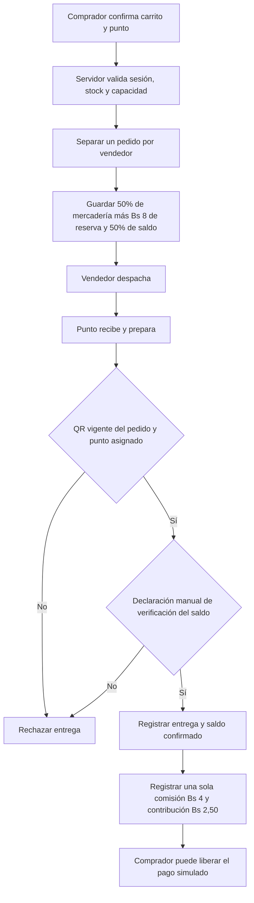

# Sprint 5 Administración y comisiones

Implementación del sprint «Administración, comisiones y cierre» de la tabla 3.1 del Documento Lock-Box, desde `main` a8f9b9a. La rama de trabajo es `feat/sprint5-admin-comisiones`.

El administrador consulta pedidos y resultados por periodo, controla la activación de perfiles y puntos, exporta comisiones y revisa el historial de cambios. Las operaciones pasan por Next.js, la API Express y funciones autorizadas de PostgreSQL. Ninguna operación procesa pagos, escrow o transferencias reales.

## Decisiones económicas confirmadas

El comprador asume Bs 8 por pedido. La tarifa corresponde al servicio de un vendedor en un punto, no a cada artículo ni a cada escaneo. Un carrito con dos vendedores produce dos pedidos y dos tarifas. La mercadería conserva su precio y pertenece al vendedor.

La reserva simula el pago del 50% de la mercadería más la tarifa completa; al recoger queda el otro 50% de la mercadería. Esta elección sobre el momento de incluir la tarifa se explicita en el checkout. El servidor calcula los importes y valida precios y existencias; no acepta valores monetarios del cliente.

| Concepto | Fórmula en Bs | Ejemplo con mercadería de Bs 200 |
|---|---|---:|
| Servicio a cargo del comprador | 8 por pedido | 8,00 |
| Reserva de mercadería | redondear(subtotal / 2; 2 decimales) | 100,00 |
| Reserva total | reserva de mercadería + servicio | 108,00 |
| Saldo al recoger | subtotal − reserva de mercadería | 100,00 |
| Total del comprador | subtotal + servicio | 208,00 |
| Comisión del punto | 4 por servicio completado | 4,00 |
| Otros costos variables estimados | 1,50 por servicio completado | 1,50 |
| Contribución de LockBox | 8 − 4 − 1,50 | 2,50 |

La contribución no es utilidad neta: no incluye costos fijos, impuestos, remuneraciones ni la estacionalidad del estudio de Tableau. Los Bs 1,50 son una estimación operativa fija de esta versión, no un gasto bancario comprobado.

Para nuevos pedidos de esta política, `commission_amount` del vendedor es cero. No se acumula la comisión porcentual histórica de los planes al servicio de Bs 8. Las suscripciones y las reglas de pedidos anteriores se conservan.

## Reconocimiento y trazabilidad

El pedido conserva una instantánea de versión, tarifa, comisión, costo estimado, reserva y saldo. La base de datos comprueba la coherencia de todos los importes. Se redondea la mitad de mercadería por pedido; el saldo es la diferencia para no perder ni crear centavos.

La comisión nace al confirmar una entrega válida, con `delivered_at` y declaración manual del saldo registrada. `private.service_accruals` tiene como clave única el pedido, por lo que la repetición de la entrega o la posterior liberación del pago no duplica ingresos ni comisión. Los reembolsados se excluyen de los reportes; el registro histórico permanece.

Los pedidos antiguos mantienen sus importes, sin cargos retroactivos ni comisiones de punto inventadas. Se identifican como política anterior en administración y no aportan ingresos al reporte de la nueva tarifa.

La declaración no equivale a validación bancaria. Tampoco se implementó aquí un proveedor de pagos ni un programador de liberación automática a las 48 horas.

## Módulo administrativo

- `/admin` exige un perfil activo con rol `admin`, verificado en servidor.
- La API vuelve a verificar JWT y rol persistido. Los RPC verifican también al administrador cuando se invocan directamente.
- Reportes por fecha de entrega en `America/La_Paz`, con intervalos de hasta 366 días. Los pedidos recientes usan fecha de creación y muestran hasta 200 registros.
- Se distinguen mercadería, ingresos por servicio, comisión del punto, otros costos estimados y contribución.
- Los pedidos de prueba se excluyen por defecto. El administrador puede incluirlos expresamente para la exposición.
- Exportación CSV de todos los puntos del reporte, con periodo y filtro de pruebas, importes de dos decimales y protección frente a fórmulas inyectadas en nombres.
- Activación y desactivación de usuarios y puntos, sin borrar datos. No se permite cambiar roles, desactivar administradores ni dejar perfiles o puntos sin atención cuando tienen pedidos pendientes.
- Cada cambio efectivo de acceso registra actor, entidad, referencia, estado y fecha. Una repetición sin cambio no genera otro evento.

No existe registro público de administradores. La cuenta de prueba solicitada se provisionó fuera del código; su contraseña no forma parte de la documentación ni del repositorio. Se accede desde el login habitual y la sesión dirige al panel correspondiente.

## Contratos de la API

| Método y ruta | Entrada | Resultado |
|---|---|---|
| GET `/api/admin/state` | `from`, `to` ISO; `includeTests=true/false` | Política, indicadores, reportes por punto y mes, pedidos, perfiles y auditoría |
| POST `/api/admin/active` | `{entity: "profile" o "point", id: UUID, active: boolean}` | Confirmación del cambio autorizado |
| GET `/api/buyer/state` | JWT comprador | Estado con tarifa por pedido y reserva/saldo persistidos |
| POST `/api/buyer/actions` | Acción validada y `requestId` | Acciones v5 con checkout idempotente y tarifa calculada en PostgreSQL |
| PATCH `/api/collection-point/:id/status` | Estado y QR; para entrega `balanceConfirmed: true` | Transición autorizada, secuencial y trazable |

Respuestas: 401 para sesión ausente o inválida; 403 para falta de permisos; 400 para entrada inválida; 404 para entidad inexistente; 409 para conflicto de negocio. Las consultas no se almacenan en caché.

## Base de datos y despliegue coordinado

1. Aplicar `database/sprint5-admin-commissions.sql`. Añade columnas compatibles, tablas privadas con RLS y RPC v5; mantiene los RPC públicos anteriores para no romper una versión v4 todavía desplegada.
2. Aplicar `database/sprint5-payment-permissions.sql`. Restringe la liberación manual a usuarios autenticados y reserva la operación de liberación por lotes al servicio de confianza.
3. Desplegar backend y frontend de esta rama. El frontend necesita `NEXT_PUBLIC_API_URL` apuntando al backend de la misma versión y las variables de Supabase/Turnstile de su entorno. Las claves oficiales de prueba de Turnstile se utilizaron solo en la configuración local ignorada por Git.
4. **Después de ambos despliegues**, aplicar `database/sprint5-activate-policy.sql`. Hace que los nombres RPC públicos anteriores deleguen a v5. Este paso es obligatorio antes de aceptar tráfico comercial: evita elegir el RPC antiguo para omitir la tarifa o la declaración del saldo. No ejecutarlo mientras el backend antiguo siga atendiendo.
5. Probar login administrativo, compra, despacho, recojo y reporte. La migración no concede por sí sola el rol administrador a usuarios existentes.

Estado al desarrollar: se aplicaron las ampliaciones compatibles y el endurecimiento de permisos en Supabase. La activación final de los RPC anteriores queda vinculada al despliegue conjunto; no se aplicó contra la aplicación v4 de `main`. El panel se verificó con frontend/backend locales y Supabase real. No se ha hecho merge ni despliegue a producción de esta rama.

Los scripts de esquema son de instalación única y deben ejecutarse mediante migraciones, no repetirse sobre una base donde ya existen sus objetos. Las migraciones remotas registradas son `sprint5_admin_commissions_v1` y `sprint5_deny_clients_and_payment_permissions`; la segunda incluye las políticas explícitas de denegación de las tablas privadas.

## Verificación

El reporte de aceptación y las limitaciones están en `SPRINT5_CIERRE.md`. Las credenciales, configuración local, tokens y scripts privados de ejecución no se incluyen en Git.
